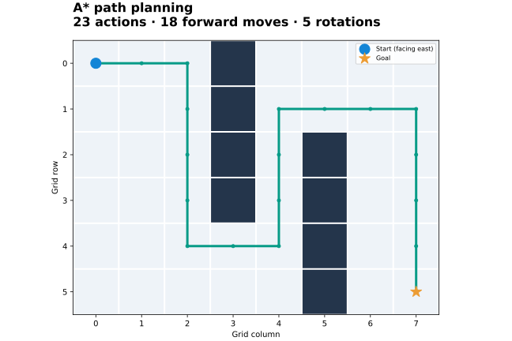

# Robot Path Planning

[](https://github.com/yiqunqiao/robot-path-planning/actions/workflows/ci.yml)


**Find routes that account for robot orientation, schedule tasks, and coordinate collision-free robot rounds.**

Runnable Python agents and PDDL domains with a bundled simulator, reproducible examples and plan validation. Course-only compiled modules are replaced by a small public adapter that uses the included search code.



## Quick start

```sh
python3 -m venv .venv
source .venv/bin/activate
pip install -r requirements.txt
python demo.py
python test_planning.py
python solve_pddl.py
```

On Windows, activate the environment with `.venv\Scripts\activate`. The demo writes a route plot and action sequence to `docs/`. The PDDL command solves the included scenarios and independently validates returned plans.

## Implementations

| Component | What to inspect |
| --- | --- |
| [Task 1](task1/agent.py) | A* over `(x, y, direction)` with parent reconstruction and repeated-state handling |
| [Task 2](task2/agent.py) | Lower bound combining coordinate coverage and required rotations |
| [Task 3](task3/agent.py) | BFS travel costs, ordered errands, cached task-order search and a greedy branch for larger task sets |
| [Single-robot domain](task4/domain-single.pddl) | Forward movement and rotation with occupancy constraints |
| [Multi-robot domain](task5/domain-multiple.pddl) | Choose/apply phases, destination and edge reservations, waits and synchronized rounds |
| [Simulator](environment.py) | Grid, robots, task assignment and episode execution |

`support/multitarget.py` supplies portable multi-target A* for Task 2. Task 3 directly reuses Task 1's public planner. Run modules from the repository root, for example `python -m task3.agent`.

## Tested behaviour

**11 November 2026 · Python 3.12 · 5/5 Python tests and 9/9 PDDL scenario checks passed.**

Python tests compare route lengths with an independent BFS oracle across orientations and obstacles, check heuristic lower bounds, run complete simulator episodes for all three agents, and check unreachable goals and exhausted budgets.

| PDDL scenarios | Result |
| --- | --- |
| Four supplied problem instances | Solved; every returned plan validated |
| Following, cyclic movement, rotation with wait | Solved; every returned plan validated |
| Direct robot swap and two robots sharing a destination | No solution; all reachable states exhausted |

[Plans and validation evidence](docs/pddl-validation.json) include the actual action sequences. Multi-robot plan lengths count the domain's selection and execution actions, not just physical robot moves. The PDDL demo uses greedy best-first search with the FF heuristic; it does not claim shortest plans.

## Project context

Search, heuristic, scheduling and domain implementations by Yiqun Qiao within the COMP90054 framework at the University of Melbourne. Framework attribution is retained. This portfolio version adds the simulator, public dependency adapter, standalone examples, regression checks and documentation; it is separate from the submitted coursework environment.

